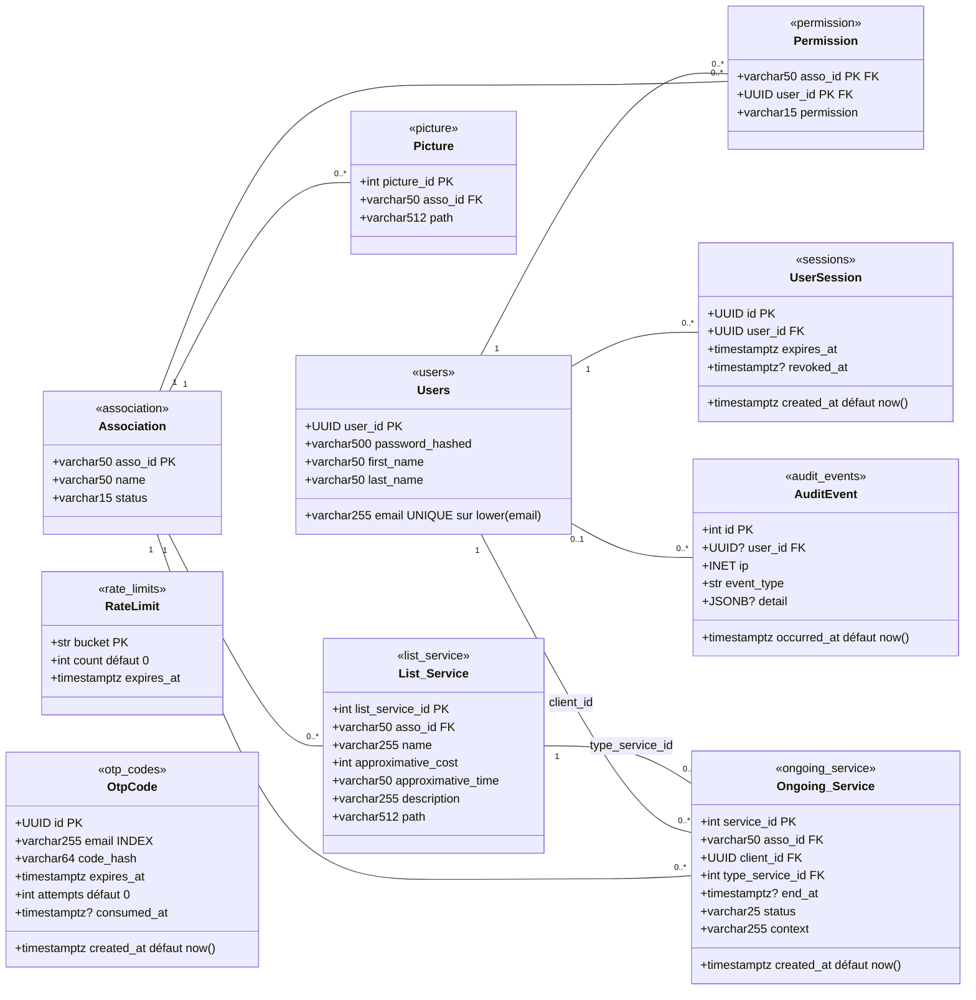

# PrestINT

Outil web de gestion des prestations proposées par les clubs et associations de TSP et d'IMT-BS, fondé sur une approche par **tickets**.

Cahier des charges complet : [`docs/cahier_des_charges.md`](docs/cahier_des_charges.md).

## Le projet

### Problème

Les associations de TSP et d'IMT-BS fédèrent de nombreux clubs qui proposent des prestations (animations, interventions, prêt de matériel…). Aujourd'hui, un client ne sait pas à qui s'adresser, personne n'a de vision de l'état d'avancement d'une demande, et chaque prestation est traitée comme un cas isolé sans réutiliser l'expérience des précédentes. Résultat : des allers-retours, des délais, et des demandes qui finissent oubliées.

### Objectif

Chaque demande devient un **ticket** avec un état, un historique et des interlocuteurs identifiés. Une **machine à états** encadre son cycle de vie (création, acceptation, refus, clôture…). Les prestations passées servent de base aux suivantes via des **templates** réutilisables.

### Fonctionnalités visées

**Côté client**

- Catalogue public (sans compte) : clubs → prestations d'un club → fiche détaillée
- Formulaire de demande de prestation
- Suivi des prestations en cours (statut, formulaire envoyé, chat dédié)
- Onglet notifications

**Côté club**

- Gestion des droits : président (admin général), responsable de prestation, collaborateurs
- Création / modification des prestations, de leur formulaire client et de leur template de gestion interne

**Planification et notifications**

- Diagrammes PERT / GANTT réutilisables, affectation de membres aux sous-tâches
- Synthèse de la prestation attribuée envoyée par chat et par mail ; rappels de jalons

**Contraintes** : Python, application web, limitation du nombre de demandes par utilisateur (anti-abus).

### État d'avancement

Fonctionnel :

- Connexion par code reçu par mail, déconnexion, sessions
- Limitation des demandes de code et journal d'audit
- Migrations et import Calend'INT (associations et membres) au démarrage
- Page d'accueil (navigation, recherche) et pages d'erreur 404 / 5xx
- CI : lint et typage

Reste à faire :

- API des prestations (`GET /api/services` n'existe pas encore : la page d'accueil affiche « Serveur injoignable ») et contenu du catalogue
- Demandes de prestation, tickets et machine à états
- Gestion des droits des clubs
- Chat et notifications
- Planification (PERT / GANTT)

### Équipe et échéance

Erwan, Matteo, Krawlya — rendu le **9 décembre**.

## Stack technique

| Brique | Techno |
|---|---|
| Frontend | Vite + React + TypeScript |
| Backend | FastAPI (Python 3.13) |
| Base de données | PostgreSQL 17 |
| Orchestration | Docker Compose |

```
.
├── apps/
│   ├── caddy/      # Caddyfile (reverse proxy, https)
│   ├── frontend/   # Vite + React + TS, Dockerfile, .dockerignore
│   └── backend/    # FastAPI, pyproject.toml, uv.lock, migrations Alembic, Dockerfile, .dockerignore
├── .github/        # CI (lint et typage)
├── docker-compose.yml
└── docs/           # cahier des charges, cahiers de labo, uml.md
```

## Lancer la stack

### Configuration .env

Un exemple de fichier `.env` est fourni dans `.env.example` :

```sh
cp .env.example .env
python3 -c "import secrets; print(secrets.token_hex(32))"   # valeur à mettre dans OTP_SECRET
```

Le mot de passe Postgres doit être le même dans `POSTGRES_PASSWORD` et `DATABASE_URL`. Il n'est pris en compte qu'à la création du volume de la base.

> Pour le moment, l'app ne fonctionne que pour les dev

### Lancer les conteneurs

Prérequis : Docker Desktop.

```sh
docker compose up --build -d   # première fois, ou après modification des dépendances
docker compose up -d        # ensuite
docker compose down         # arrêter
docker compose down -v      # arrêter ET réinitialiser la base (et les certificats de Caddy)
```

| Service | URL | Remarque |
|---|---|---|
| Application | https://prestint.localhost | via Caddy, seuls ports exposés publiquement : 443 (et 80, redirigé vers https) |
| Mails (Mailpit) | https://mail.prestint.localhost | via Caddy, capture tous les mails envoyés |
| API (Swagger) | http://localhost:8000/docs | mode dev uniquement : `DEV_DOCS=1` dans `.env` (déjà présent dans `.env.example`, laisser vide pour désactiver) — accessible uniquement depuis la machine hôte |
| Panneau d'administration | http://localhost:8000/admin | mode dev uniquement, même variable `DEV_DOCS` — accessible uniquement depuis la machine hôte |
| PostgreSQL | aucun port publié | `docker compose exec db sh -c 'psql -U "$POSTGRES_USER" "$POSTGRES_DB"'` |

Vérification rapide que tout communique :

```sh
curl -k https://prestint.localhost/api/health   # → {"db":1}
```

### Se connecter

1. Sur https://prestint.localhost, onglet Connexion, saisir une adresse `prenom.nom@telecom-sudparis.eu`.
2. Lire le code reçu dans Mailpit (https://mail.prestint.localhost). Il est valable 5 minutes.
3. Saisir le code. Le compte est créé à la première connexion.

> **Réseaux ignorés silencieusement.** Avec d'anciennes versions de Docker (constaté avec Engine 24 / Compose v2.19), un conteneur relié à plusieurs réseaux peut être créé sans l'un d'eux, sans aucune erreur (ex. `backend` sans `data` → `failed to resolve host 'db'`, `caddy` sans `mail_mock` → 502 sur Mailpit, `caddy` sans `edge` → site injoignable). Vérifier les réseaux d'un conteneur :
>
> ```sh
> docker inspect -f '{{range $k,$v := .NetworkSettings.Networks}}{{$k}} {{end}}' prestint-backend-1
> ```
>
> Si un réseau manque, reconnecter `backend` et `caddy` (les erreurs « already exists » sont sans conséquence) :
>
> ```sh
> for n in edge data mail_mock; do docker network connect --alias backend prestint_$n prestint-backend-1; done
> for n in edge mail_mock; do docker network connect --alias caddy prestint_$n prestint-caddy-1; done
> docker restart prestint-backend-1 prestint-caddy-1
> ```
>
> Attendre une quinzaine de secondes que le backend redémarre. À refaire après chaque recréation des conteneurs (`down` puis `up`, `up --build`) ; `docker compose stop` / `start` conservent les réseaux. Mettre à jour Docker Desktop corrige le problème durablement.

## Schéma de la stack

```
Navigateur
   │  https://prestint.localhost          https://mail.prestint.localhost
   ▼                                                  │
┌──────────────┐                                      │
│    caddy     │ ◄────────────────────────────────────┘
│    :443      │ ──────────────────────────────────────────┐
└──────────────┘                                           ▼
       │                                           ┌──────────────┐
       ▼                                           │   mailpit    │
┌──────────────┐  /api/*  ┌──────────────┐  SMTP   │ :8025 / 1025 │
│   frontend   │ ───────► │   backend    │ ──────► └──────────────┘
│  Vite (dev)  │  proxy   │   FastAPI    │
│    :5173     │          │    :8000     │  DATABASE_URL  ┌──────────────┐
└──────────────┘          └──────────────┘ ─────────────► │      db      │
                                                          │ PostgreSQL 17│
                                                          │    :5432     │
                                                          └──────────────┘
   réseaux : edge (caddy, frontend, backend), data interne (backend, db),
             mail_mock interne (caddy, backend, mailpit)
```

- **Un seul point d'entrée.** Le navigateur ne parle qu'à Caddy (`:443`), qui relaie vers Vite (`frontend:5173`) ou Mailpit (`mailpit:8025`) selon le nom de domaine. Les certificats sont émis par l'autorité locale de Caddy : accepter l'avertissement du navigateur la première fois. Tout appel vers `/api/*` est relayé par le proxy de Vite (`server.proxy` dans `vite.config.ts`) vers `http://backend:8000`, cible fournie par la variable `VITE_PROXY_TARGET`. Même origine côté navigateur → pas de CORS à gérer.
- **Backend → base.** Le backend lit `DATABASE_URL=postgresql+psycopg://user:password@db:5432/prestint`. Le nom `db` est résolu par le DNS interne de Compose.
- **Démarrage du backend.** `entrypoint.sh` applique les migrations, importe les associations et membres depuis Calend'INT (un échec de l'import ne bloque pas le démarrage), puis lance uvicorn.
- **Ordre de démarrage.** `db` a un `healthcheck` (`pg_isready`) ; `backend` déclare `depends_on: db: condition: service_healthy` et ne démarre donc qu'une fois Postgres prêt.
- **Ports.** Seuls `443` et `80` (Caddy) sont publiés sur toutes les interfaces ; `8000` n'est lié qu'à `127.0.0.1` (confort de dev depuis la machine hôte, invisible depuis l'extérieur). Postgres n'est publié sur aucun port : `data` est un réseau interne.
- **Hot-reload.** Les dossiers `apps/backend` et `apps/frontend` sont montés dans les conteneurs : uvicorn tourne avec `--reload`, Vite fait du HMR. Des volumes anonymes (`/app/node_modules` pour le frontend, `/app/.venv` pour le backend) conservent les dépendances Linux installées dans l'image plutôt que celles de la machine hôte.
- **Persistance.** Les données Postgres vivent dans le volume nommé `postgres_data` (supprimé par `down -v`).
- **Images propres.** Les `.dockerignore` excluent `node_modules`, `dist`, `__pycache__`, `.venv`, `.env` du contexte de build.

## Modèle de données

Source : `apps/backend/src/infra/models/`. `?` = colonne nullable, stéréotype = nom de la table. Notes complémentaires : [`docs/uml.md`](docs/uml.md). Le schéma décrit les modèles ; les migrations présentent encore quelques écarts (par exemple la colonne `permission.permission`, absente de la base).



**Légende — fichier source** (`apps/backend/src/infra/models/`)

| Fichier | Classes |
|---|---|
| `identity.py` | Association, Users, Permission, Picture, List_Service, Ongoing_Service |
| `audit.py` | UserSession, AuditEvent, RateLimit, OtpCode |

## Développement

- Les routes backend doivent être préfixées par `/api` pour passer par le proxy. `apps/backend/src/main.py` expose `GET /api/health`, qui exécute `SELECT 1` sur la base, et les routes d'authentification (`/api/auth`).
- Les identifiants Postgres viennent de `.env` : changer les valeurs de `.env.example` avant tout déploiement.
