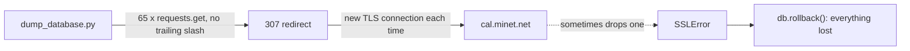

# Calend'INT dump: admin panel error and empty tables

> A guide, not a solution. You write the code; this tells you what goes where and why.

**Symptoms:** `/admin` crashes on the Permission view, and `association` / `permission` are empty even though the dump runs at every backend start.

**Two separate causes:** the `Permission` model has a column the database doesn't have, and the dump fails partway through because a request to Calend'INT drops at random, which rolls back everything.

**Effort:** one new Alembic migration, a one-line model change, and about five changed lines in `dump_database.py`. No new dependency, no `docker-compose.yml` or `entrypoint.sh` change.

---

## 1. Admin panel: `column permission.permission does not exist`

Backend log when the Permission view opens:

```
psycopg.errors.UndefinedColumn: column permission.permission does not exist
[SQL: SELECT ... permission.asso_id, permission.user_id, permission.permission FROM permission ...]
```

| Where | `permission` column? |
|---|---|
| `docs/uml.md` | yes, `varchar15 permission` |
| `apps/backend/src/infra/models/identity.py` (`Permission`) | yes, `Mapped[str] = mapped_column(String(15))` |
| `alembic/versions/0bb00f03e3b1_identity_models.py` | **no**, only `asso_id` and `user_id` |
| Real DB (`\d permission`) | **no** |

sqladmin selects every column the model maps, so it asks Postgres for a column the migration never created.

### Fix

The UML and the model agree, so the migration is what's wrong. Add a new migration instead of editing `0bb00f03e3b1`: that one has already run on every existing DB.

```sh
docker compose exec backend uv run --no-sync alembic revision -m "permission column"
```

In the generated file:

```python
def upgrade() -> None:
    op.add_column("permission", sa.Column("permission", sa.String(length=15), nullable=True))


def downgrade() -> None:
    op.drop_column("permission", "permission")
```

The column is **nullable** because the dump doesn't fill it. A `NOT NULL` column without a default would make every dump insert fail. Match the model:

```python
permission: Mapped[str | None] = mapped_column(String(15))
```

`entrypoint.sh` already runs `alembic upgrade head` at start, so a restart applies it.

**Optional:** each member in the API carries a `role` field. To fill the column, read `user["role"]` in the dump and add it to the `INSERT INTO permission`. Check its length against `String(15)` first.

---

## 2. Empty tables: the dump fails partway and rolls back

State after the last start: alembic at head, `association` = 0, `users` = 1, `permission` = 0.

The startup log (`docker compose logs backend`, after `[1/2] Application des migrations...`) shows the dump crashing on a members call:

```
File "/app/src/calendint_dump/dump_database.py", line 34, in dump_database
urllib3.exceptions.MaxRetryError: HTTPSConnectionPool(host='cal.minet.net', port=443):
  Max retries exceeded with url: /api/organizations/63cd9152-.../members
  (Caused by SSLError(SSLEOFError(8, '[SSL: UNEXPECTED_EOF_WHILE_READING] ...')))
```

### Why it happens



- Each `requests.get(...)` opens a **new TLS connection**. With no shared session, nothing is reused.
- The URLs have no trailing slash, so the server answers `307` to `.../organizations/` and `.../members/` first. That doubles the requests, to about 130 handshakes per run.
- The server drops a connection now and then, and a different org fails each time. The log shows BDE. A manual re-run from inside the container got 63 OK out of 64 and failed on "Organisation Supprimée", and that same URL works on retry.
- One failure is enough to lose everything: the `except` block calls `db.rollback()`, and the commit only happens at the very end.
- `entrypoint.sh` ends the dump line with `|| echo "CalendINT : vérification échouée"`, so the backend still boots, with empty tables, and the error stays buried in the log.

Tested from the backend container: the same 64 member calls through **one `requests.Session`** with **trailing-slash URLs** went 64 out of 64 OK.

### Fix in `apps/backend/src/calendint_dump/dump_database.py`

1. Create one session at the top of `dump_database()` and use it for every call:

   ```python
   session = requests.Session()
   ```

2. Replace both `requests.get(` calls with `session.get(` and add the trailing slashes:

   ```python
   response = session.get("https://cal.minet.net/api/organizations/", timeout=30)
   ```
   ```python
   response = session.get(
       f"https://cal.minet.net/api/organizations/{asso_id}/members/", timeout=30
   )
   ```

3. **Optional, for extra robustness:** retry dropped connections. `urllib3` is already installed through `requests`, so this adds no dependency:

   ```python
   from requests.adapters import HTTPAdapter
   from urllib3.util import Retry

   session = requests.Session()
   session.mount("https://", HTTPAdapter(max_retries=Retry(total=3, backoff_factor=1)))
   ```

Keep the all-or-nothing transaction and the `|| echo` in `entrypoint.sh`. A half-imported DB is worse than an empty one, and the backend should still boot when Calend'INT is down.

### Not a bug: `failed to resolve host 'db'`

The very first start in the log fails the migrations with `failed to resolve host 'db'`. The container restarted and the second attempt worked. It only happens while the network is still coming up.

---

## 3. Check it works

1. Restart: `docker compose restart backend`
2. Log: `docker compose logs backend | grep -i -E "import|calendint"` shows `Import des associations et utilisateurs terminé !`
3. Counts:

   ```sh
   docker compose exec db sh -c 'psql -U "$POSTGRES_USER" -d "$POSTGRES_DB" -c "select (select count(*) from association) a, (select count(*) from permission) p;"'
   ```

   Expect `a = 64` and `p` close to 259 (265 members minus the 6 with no `full_name`). Those counts are from 2026-11-27 and will drift as Calend'INT changes.
4. `/admin`, Permission view: opens and lists rows.
