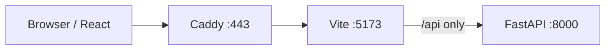

# Custom HTTP error pages

> A guide, not a solution. You write the code; this tells you what goes where and why.

**Goal:** show custom pages for HTTP client (4xx) and server (5xx) errors.

**Decision:** one dynamic React component, plus one small page in the Caddyfile for when React can't load. The pages differ only by their text, so one file per status would repeat the layout. With one component, a new status is one new line.

**Effort:** one new component, small edits to `api.ts` and `acceuil.tsx`, one line in `App.css`, and one block in the Caddyfile. No router, no new dependency, no `docker-compose.yml` change.

---

## 1. Where an error comes from



A request stops at the first layer that rejects it. The status then travels back unchanged: Caddy does not replace a 4xx or 5xx sent by Vite or FastAPI.

## 2. What React can see

When the error happens matters more than which code it is.

| When | What React can do |
|---|---|
| **During page load** | Nothing. React isn't running yet, and JS can't read the HTTP status of its own page. Only Caddy can show a custom page. |
| **During a `fetch` from a running page** | Read `res.status`, whichever layer produced it, and show what it wants. |
| **No HTTP response at all** (Caddy down, offline, TLS failure) | `fetch` rejects, so it lands in `.catch` with no status. On page load, the browser shows its own error page. |

**A wrong page URL is not an HTTP error here.** Vite answers `GET /nimporte` with 200 and `index.html`, so only React can decide that a URL doesn't exist.

## 3. Codes by layer

MDN lists 40 codes in the 4xx and 5xx ranges. "Only" holds for just 10 of them, so the codes are split into five groups:

| Group | Count |
|---|---|
| Only Caddy | 3 |
| Only Vite | 5 |
| Only FastAPI | 2 |
| More than one layer | 7 |
| No layer today | 23 |

### Only Caddy

Go's HTTP server, which Caddy runs on, sends these before the request is forwarded.

| Code | Trigger | What it means for React |
|---|---|---|
| 417 Expectation Failed | Unknown `Expect` header | Never seen: browsers don't send these requests |
| 501 Not Implemented | Unknown `Transfer-Encoding` | Never seen |
| 505 HTTP Version Not Supported | Invalid HTTP version | Never seen |

### Only Vite

Vite only runs in dev (`apps/frontend/Dockerfile` runs `npm run dev`). If production ever serves a `vite build` instead, this group and the Vite columns below no longer apply.

| Code | Trigger | What it means for React |
|---|---|---|
| 403 Forbidden | File outside the project (`/@fs/...`), or a Host not allowed by Vite | Never seen from app code. FastAPI will share this code if a permission route raises it |
| 408 Request Timeout | Client too slow to send its request | Never seen |
| 413 Content Too Large | Oversized chunk extensions | Never seen |
| 416 Range Not Satisfiable | Bad `Range` on a `public/` file | Never seen |
| 426 Upgrade Required | Plain HTTP on the hot-reload WebSocket | Never seen |

### Only FastAPI

These always reach React through `fetch`, because the browser only talks to FastAPI through `/api`.

| Code | Trigger | What it means for React |
|---|---|---|
| 401 Unauthorized | Session missing, invalid or expired (`session.py:33,46`) | Show the login screen, not an error page |
| 422 Unprocessable Content | Validation failure, including broken JSON or a wrong `Content-Type` | Show it inline in the form (`compte.tsx:31`) |

### More than one layer

| Code | Caddy | Vite | FastAPI | What it means for React |
|---|---|---|---|---|
| 400 Bad Request | Malformed request, missing Host | `#` in the raw URL, malformed request | Wrong OTP (`routes.py:80`), unparsable body | Only FastAPI's reaches React: show it inline (`compte.tsx:45`) |
| 404 Not Found | | Asset or non-GET request on an unknown path | Unknown `/api/*` route | From `fetch`: `Erreur` page. From ``: use `onError`. Not for page URLs (section 2) |
| 405 Method Not Allowed | Method name over 32 characters | | Wrong method on `/api/*` | Only FastAPI's reaches React. It means a frontend bug: `Erreur` page |
| 431 Request Header Fields Too Large | Headers over 1 MB | Headers or URL over 16 KB | | Vite's limit hits first. From `fetch`: `Erreur` page. On page load: React can't start |
| 500 Internal Server Error | Rare internal failure | Vite can't compile a file (dev only) | Unhandled exception, such as the database being down | FastAPI's: `Erreur` page. Vite's: React doesn't start, and Vite shows its overlay |
| 502 Bad Gateway | **Vite** unreachable | **FastAPI** unreachable | | On page load: Caddy page. From `fetch`: `Erreur` page |
| 504 Gateway Timeout | Timeout reaching Vite | Dependency optimizer restarted (dev only) | | Same as 502. Vite's goes away on reload |

**Read `res.status`, not the body.** Only some bodies are JSON: FastAPI's 500 is plain text, Vite's 502 is empty and Caddy's will be HTML, so `res.json()` would throw on them.

### No layer today

| Code | Why not |
|---|---|
| 414 URI Too Long | Long URLs get 431 instead |
| 415 Unsupported Media Type | A wrong `Content-Type` gets 422 instead |
| 421 Misdirected Request | Caddy's `strict_sni_host` is off |
| 429 Too Many Requests | The OTP rate limit returns 204 like a normal request (`otp.py:76`) |
| 503 Service Unavailable | Needs Caddy health checks or Uvicorn's `--limit-concurrency`, and neither is set |
| 402, 406, 407, 409, 410, 411, 412, 418, 423, 424, 425, 428, 451, 506, 507, 508, 510, 511 | Nothing in the stack sends them |

If you later `raise HTTPException(code)` with one of these, it becomes a FastAPI code: React reads it through `fetch`, and it gets the `Erreur` page unless you handle it inline.

## 4. What React does with each case

| Case | React shows |
|---|---|
| 400, 422 | Inline form message (already done in `compte.tsx`) |
| 401 | Login screen (already done through `fetchMe`) |
| Unknown page URL | `Erreur` with 404 |
| Any other failure of `/auth/me` | `Erreur` with that status |
| `fetch` rejected, no status | `Erreur` with 503, used only as a display value |
| React can't load | Nothing: Caddy answers |

## 5. What to change

### Step 1: new component `apps/frontend/src/pages/erreur/erreur.tsx`

The page has one fixed layout, and only the code and message change.

```tsx
// Only codes that need their own wording. Everything else uses the fallbacks below.
const MESSAGES: Record<number, string> = {
  403: "Vous n'avez pas accès à cette page.",
  404: "Cette page n'existe pas.",
  429: 'Trop de tentatives, réessayez dans quelques minutes.',
}

function Erreur({ status }: { status: number }) {
  const message =
    MESSAGES[status] ??
    (status >= 500
      ? 'Le service rencontre un problème, réessayez dans quelques instants.'
      : "Votre demande n'a pas pu être traitée.")

  return (
    <>
      <h1>{status}</h1>
      <h2>{message}</h2>
      <p>
        <a className="counter" href="/">
          Retour à l'accueil
        </a>
      </p>
    </>
  )
}

export default Erreur
```

Add `text-decoration: none;` to `.counter` in `apps/frontend/src/App.css`, so the link looks like your other buttons.

**Codes nobody sends yet:** `<Erreur status={418} />` already works, and so does any other number. Better wording for a code is one new line in `MESSAGES`.

**Why so few messages:** 5xx errors all mean the same thing to a visitor (try again later), so they share one message. Only codes where the visitor would do something different get their own.

What stays the same on every error page:

| Part | How | Work needed |
|---|---|---|
| Background | Already global: `index.css` styles `:root` and `#root` | None |
| Buttons | Reuse the `.counter` class. Anything added next to the link appears on every error page | The CSS line above |
| Nav bar | Render it once in `App` (`acceuil.tsx`) around the page branches, so `Erreur` never needs to know about it | When you add it: none exists yet |

- **Nav bar and `user`:** on error pages `user` can still be `undefined`, because the 404 renders before `/auth/me` answers and a failed `/auth/me` never sets it. The nav bar must handle that case.
- **The `<p>` around the link:** `#root` is a flex column, so without it the link would stretch across the full width.
- **The `<a>`:** it does a full reload, which also retries `/auth/me`, so no router is needed for two routes.
- **Later API calls:** when a page needs a full-page error, pass it `onError={setFailure}`, the same pattern as `onLogin` and `onLogout`. There's nothing to add until a route needs it.
- **Caddy page exception:** it can't reuse the React nav bar, because it only appears when React can't load. It stays a small standalone page (step 4).

### Step 2: `apps/frontend/src/api.ts`

Today `fetchMe` returns `null` for any failure, so a backend outage shows the login form.

```ts
export async function fetchMe(): Promise<User | null> {
  const res = await fetch(`${API}/auth/me`)
  if (res.status === 401) return null
  if (!res.ok) throw new Error('GET /auth/me failed', { cause: res.status })
  return res.json()
}
```

- Logged-out users still get the login screen, because every invalid session returns 401.
- `{ cause }` avoids a custom error class. `tsconfig.app.json` targets ES2023, so it compiles.
- The other caller, `compte.tsx:49`, already runs inside `run()`'s try/catch, so it needs no change.

### Step 3: `apps/frontend/src/pages/acceuil.tsx`

`App` can only show the login form or the dashboard today. Two things stop it from showing `Erreur`: the URL-sync effect rewrites every path to `/` or `/dashboard`, and a failed `/auth/me` is treated as logged out.

The change has three parts:

1. **Detect the error.**
   - `notFound` checks the URL on every render. It doesn't need state, because leaving the page is a full reload.
   - `failure` stores the HTTP status when `/auth/me` fails. `e.cause` is the status `fetchMe` attached in step 2. If there's no cause, the server never answered, so there's no real status and 503 is only what gets displayed.
2. **Make the URL sync skip unknown paths.** Without this guard, `/nimporte` would change to `/` while the 404 page stays on screen.
3. **Show the page.** The order of the checks matters. A failed `/auth/me` never sets `user`, so it stays `undefined`, and checking that first would leave the page blank forever. Checking `notFound` first also shows the 404 without waiting for `/auth/me`.

The complete file:

```tsx
import { useEffect, useState } from 'react'
import '../App.css'
import { fetchMe, type User } from '../api.ts'
import Compte from './compte/compte.tsx'
import Dashboard from './dashboard/dashboard.tsx'
import Erreur from './erreur/erreur.tsx'

const KNOWN_PATHS = ['/', '/dashboard']

function App() {
  // undefined = still asking /me, null = logged out
  const [user, setUser] = useState<User | null | undefined>(undefined)
  const [failure, setFailure] = useState<number>()
  const notFound = !KNOWN_PATHS.includes(location.pathname)

  useEffect(() => {
    // no cause = network failure, so there is no real HTTP status
    fetchMe().then(setUser).catch((e) => setFailure(e.cause ?? 503))
  }, [])

  // The page follows the login state; keep the URL in sync with it (logged in -> /dashboard, else /)
  useEffect(() => {
    if (user === undefined || notFound) return
    const want = user ? '/dashboard' : '/'
    const sync = () => {
      if (location.pathname !== want) history.replaceState(null, '', want)
    }
    sync()
    window.addEventListener('popstate', sync)
    return () => window.removeEventListener('popstate', sync)
  }, [user, notFound])

  if (notFound) return <Erreur status={404} />
  if (failure) return <Erreur status={failure} />
  if (user === undefined) return null

  if (user) {
    return <Dashboard user={user} onLogout={() => setUser(null)} />
  }

  return (
    <>
      <h1> PrestINT </h1>
        <h2> Prestations des clubs de l'INT </h2>
        <Compte onLogin={setUser} />
    </>
  )
}

export default App
```

What each case shows:

| URL | `/auth/me` answer | Page shown |
|---|---|---|
| Unknown, such as `/nimporte` | Any | 404, URL unchanged |
| `/` or `/dashboard` | Still waiting | Blank, as today |
| `/` or `/dashboard` | 401 | Login |
| `/` or `/dashboard` | 200 | Dashboard |
| `/` or `/dashboard` | Other error, such as 500 or 502 | `Erreur` with that status |
| `/` or `/dashboard` | No response | `Erreur` with 503 |

### Step 4: `apps/caddy/Caddyfile`

Add this to the `(shared)` snippet so both sites get it. The Caddyfile is already mounted, so `docker-compose.yml` doesn't change. The styles are inline because `index.css` can't load in this case, and the status is passed explicitly because `respond` defaults to 200.

```
handle_errors {
	header Content-Type "text/html; charset=utf-8"
	respond <<HTML
		<!doctype html>
		<html lang="fr" style="color-scheme: light dark">
		<meta charset="utf-8">
		<title>{err.status_code} - PrestINT</title>
		<body style="font: 18px/145% system-ui, sans-serif; text-align: center; margin-top: 20vh">
		<h1>{err.status_code}</h1>
		<p>PrestINT est momentanément indisponible, réessayez dans quelques instants.</p>
		HTML {err.status_code}
}
```

This only covers errors from Caddy's handlers, such as a 502 from `reverse_proxy`. It doesn't replace responses from Vite or FastAPI, or the raw rejections sent by Go's HTTP server.

## 6. Known limits and gaps

- **Soft 404:** the React 404 page is still HTTP 200 on the wire. Visitors can't tell, so this doesn't matter for this app.
- **Direct API visits:** opening `/api/nope` in the address bar shows FastAPI's raw JSON, because React isn't involved.
- **New pages:** a third page has to go in `KNOWN_PATHS` and in the sync effect, which only knows two paths.
- **Trailing slash:** `/dashboard/` shows the 404 page.
- **Sign-in form:** `compte.tsx:31` only checks for 422, so a 500 or 502 from `/auth/otp/request` still says the code was sent.
- **Logout:** `dashboard.tsx:12` ignores the status, so a failed logout looks like it worked while the session stays valid.

## 7. How to test

Run from the repo root. `admin off` disables `caddy reload`, so Caddyfile changes need `docker compose restart caddy`.

1. `cd apps/frontend && npm run build && npm run lint`
2. Open `https://prestint.localhost/nimporte`: expect the 404 page, with the URL unchanged.
3. Open `/` and `/dashboard`, logged in and logged out: redirects behave as before.
4. Delete the `session` cookie and reload: expect the login screen, not an error page.
5. `docker compose stop backend`, then reload `/`: expect the 502 page instead of the login form. Then `docker compose start backend`.
6. `docker compose stop frontend`, then `curl -ik https://prestint.localhost`: expect status 502 with the HTML body. Then `docker compose start frontend`.
7. `curl -sk https://prestint.localhost/api/nope`: expect FastAPI's JSON 404, which shows Caddy isn't replacing it.
8. Temporarily render `<Erreur status={418} />`, then `<Erreur status={599} />`: expect the client message, then the server message.

Step 6 is the one to watch. The Caddy docs don't explicitly say that a failed connection to the upstream triggers `handle_errors`, and so far the block has only been parsed by `caddy adapt`, not run.

## 8. How these codes were checked

Versions: Caddy 2.11.4, Vite 8.3.0, FastAPI 0.141.1, Starlette 1.7.0, Uvicorn 0.53.0. Code list from [MDN](https://developer.mozilla.org/en-US/docs/Web/HTTP/Reference/Status).

- **Triggered on the local stack:** Caddy 400, 405, 417, 431, 501, 505; Vite 403, 404, 431; FastAPI 401, 404, 405, 422.
- **Read in source only, not triggered:** Caddy 500, 502, 504 (from the `master` branch, not the 2.11.4 tag); Vite 400, 408, 413, 416, 426, 500, 502, 504; FastAPI 400, 500.
- **Not listed by MDN:** Caddy also logs a non-standard 499 when the client disconnects. The client is gone by then, so nobody sees it.
- **Not errors, so left out:** redirects such as Caddy's 308 (HTTP to HTTPS) and FastAPI's 307 (trailing slash). `fetch` follows them automatically.
