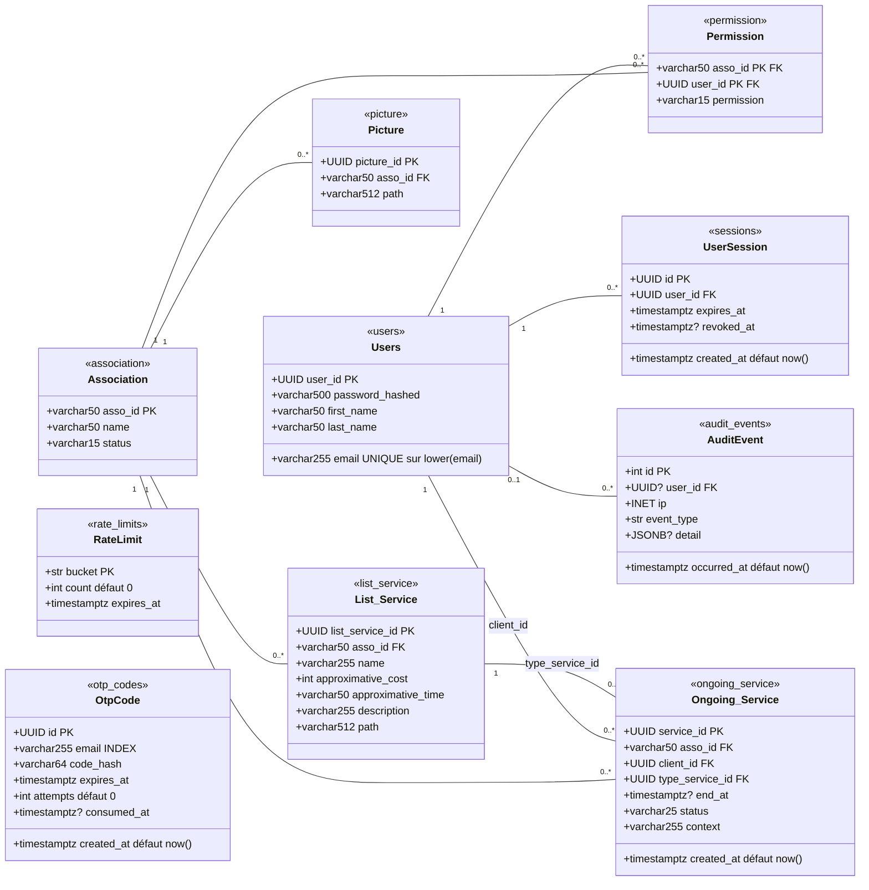

# UML — modèles SQLAlchemy

Source : `apps/backend/src/infra/models/` (identity.py, audit.py). Toutes les classes héritent de `Base(DeclarativeBase)`.

**Légende — fichier source** (`apps/backend/src/infra/models/`)

| Fichier | Classes |
|---|---|
| `identity.py` | Association, Users, Permission, Picture, List_Service, Ongoing_Service |
| `audit.py` | UserSession, AuditEvent, RateLimit, OtpCode |

Remarques :
- `?` = colonne nullable. Stéréotype = nom de la table.
- `RateLimit` et `OtpCode` sont isolées (aucune clé étrangère).
